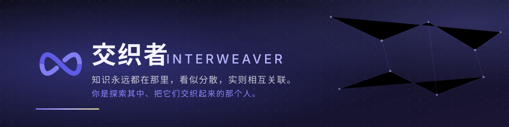

<div align="center">



<br>

<a href="#主旨-为什么是交织者"><b>主旨</b></a> &nbsp;·&nbsp;
<a href="#功能-能做什么"><b>功能</b></a> &nbsp;·&nbsp;
<a href="#技术-怎么做到的"><b>技术</b></a> &nbsp;·&nbsp;
<a href="#未来-要往哪去"><b>未来</b></a> &nbsp;·&nbsp;
<a href="#快速开始"><b>快速开始</b></a> &nbsp;·&nbsp;
<a href="#文档索引"><b>文档索引</b></a>

<br><br>


<br><br>

<b>一块会动的电子草稿纸：把数学画出来，把关系连起来，把知识长成一张网。</b>

<sub>零依赖 · 原生 ESM · Canvas 实时渲染 · 语义化成就网 · 本地优先</sub>

</div>

<br>


<a id="主旨-为什么是交织者"></a>

## 主旨 — 为什么是"交织者"

<div align="center">
<sub>

> 知识永远都在那里，看似分散，实则相互关联。<br>
> 用户是探索其中、把它们交织起来的那个人。

</sub>
</div>

绝大多数数学工具都在做同一件事：**把答案画出来**。
而交织者想做的是另一件事 —— **让你看见"关系"本身**。

| | 常规学习工具 | 交织者 Interweaver |
| --- | --- | --- |
| 你得到的 | 一个结果、一条静态曲线 | **一个可以拖、可以改、会联动的关系网** |
| 参数是什么 | 写死的数字 | **一根滑杆**：拖动它，图形与你一起重新理解 |
| 两个东西有关系 | 概念上是"有关系的"，屏幕上互不相干 | **一根看得见的线**：动一个，另一处跟着动 |
| 做完一道题 | 关掉，归零 | **知识网亮起一颗星**，与已掌握的连成一片 |
| 学到的形状 | 零散的珠子 | **一张网** |

三种"灵魂"体验，也是这个产品所有功能的设计支点：

<div align="center">

| ① 看得见的关系 | ② 动一下就懂 | ③ 知识会长成网 |
| :---: | :---: | :---: |
| 变量、绑定、约束都是**可视的实体**，不是隐藏的代码 | 每一处改动都**实时重算**并即时反馈 | 成就不是分数，是**语义识别**出的"你真正做出来了什么" |

</div>

<br>

<a id="功能-能做什么"></a>

## 功能 — 能做什么

<div align="center"><sub>以下全部可交互、可实时反馈；括号内为真实实现方式</sub></div>

| 模块 | 能力 |
| --- | --- |
| **电子草稿纸** | 无限画布、平移缩放、网格与刻度、深浅主题、自动草稿（断线不丢） |
| **绘制工具** | 线段 / 圆 / 弧 / 自由曲线 / 多边形 / 点、吸附、多选、整组拖动 |
| **参数系统** | 每个实体都暴露参数（半径、斜率、截距、A / λ / φ …），面板内可直接改 |
| **变量与滑杆** | 建变量、拉滑杆、自动动画播放；**图形跟着变量动** |
| **关联（绑定）引擎** | 把任意参数关联到表达式或变量；一处变，处处联动 |
| **约束系统** | 平行 / 垂直 / 等长等硬约束，求解器保证几何关系严格成立 |
| **函数生成器** | 输入 `y = sin(x)` 直接成图；**纯正弦/余弦会自动生成带 A/λ/φ 参数的正弦波实体** |
| **预设库** | 11 个可拖出的成品：正弦波、余弦波、抛物线、直角三角形、黄金矩形、阻尼振荡、预织好的"圆-正弦联动"网等 |
| **微积分工具组** | 曲线下面积、导函数曲线、t 参数模式、闭曲线面积（格林公式） |
| **傅里叶变换** | 任意曲线一键拆成谐波（可调保留谐波数 N，实时显示 RMS 误差） |
| **成就与知识网** | 语义识别你在场景里"做成了什么"，点亮星图并自动连线 |
| **账号与同步** | 注册/登录、画布与成就云端同步、按账号隔离的本地数据 |

<details>
<summary><b>展开：几个"别人没有"的实现细节</b></summary>

<br>

- **曲线永远贴合屏幕**：采样范围 = 视口 ∩ 定义域，采样密度按屏幕像素自适应。所以"缩小画面"不会让波变形，也不会为了几万单位外的世界浪费算力。
- **绑定的物理直觉**：被硬约束固定的线被当作"铁棍"——不会变形，只会整体平移，并把位移传给粘在它上面的东西。
- **成就靠语义，不靠埋点**：引擎读取场景的**结构语义**（谁和谁绑在一起、约束是否成立、是否存在对称/闭合），而不是统计点击次数。
- **渲染按需**：静置时零重绘；只有"脏了"（状态变化、相机移动、拖动预览）才画一帧。

</details>

<br>

<a id="技术-怎么做到的"></a>

## 技术 — 怎么做到的

<div align="center">

| 维度 | 选择 |
| --- | --- |
| **运行时依赖** | **0**（`dependencies: {}`；只把 puppeteer 装在 devDependencies 里跑端到端测试） |
| **模块体系** | **原生 ESM**，无打包器、无转译；`app/src/` 下 **52 个 .js** 直接跑 |
| **渲染** | **Canvas 2D** 手写渲染管线：视口自适应采样 + 屏幕列包络 + 相机签名缓存 |
| **后端** | `node:http` + **`node:sqlite`**（Node 内置），单文件 API 服务 |
| **服务拓扑** | `server.mjs`（静态 **5188**）+ `server-api.mjs`（API **5189**），前后端分离 |
| **品牌** | `app/brand/` 下零依赖矢量：主标记 / 深空 / 单色 / 横版 / favicon + 规范页（最小 16px、等比、不加效果） |
| **质量门** | `npm run verify` 一条命令跑 **≈498 条自动化断言**（API / 数学 / 布局 / 视觉 / 端到端 / 性能） |

</div>

**实测数字**（`npm run verify` 里跑出来的，不是估算）：

```
端到端 E2E            264 通过 / 0 失败
API·数学·曲线等 check  158 通过 / 0 失败
布局核验                61 通过 / 0 失败
视觉核验                15 通过 / 0 失败（像素级：标签底垫、命中手柄、弧段粗细…）
性能回归                5 个合成波 → 61fps · 单次 draw 0.05~0.14ms
真实数据库              跑前跑后 users 恒为 4（测试只写临时库，绝不碰用户数据）
```

<br>

<a id="未来-要往哪去"></a>

## 未来 — 要往哪去

<div align="center"><sub>路线图见 <a href="./docs/05-实施路线图-P1至P20.md">05-实施路线图（P1–P20）</a></sub></div>

| 阶段 | 目标 |
| --- | --- |
| **已落地** | 草稿纸与绘制、参数/变量/滑杆、关联与约束、函数生成器、预设库、微积分、傅里叶、成就网与星图、账号同步 |
| **进行中** | **渲染优化（#10）**：30 个谐波波在最小缩放下稳定 60fps；采样彻底摆脱固定间隔，避免缩小后平移形变 |
| **接下来** | 更丰富的语义成就（跨实体关系识别）· 知识网的可视化打磨 · 场景分享与模板 · 移动端触控体验 |
| **更远** | 从数学扩展到物理/化学等理科（架构已预留扩展点）· PWA / 桌面壳 · 本地与云端的混合存储 |

> 不变的原则：**看得见、动得了、连得上**。功能可以加，这三件事不妥协。

<br>

<a id="快速开始"></a>

## 快速开始

只要 **Node.js**（无需 `npm install` 运行时依赖）。根目录三个双击即用的脚本：

| 脚本 | 作用 |
| --- | --- |
| `start.bat` | **一键启动**：检测 Node、检查端口、后台起两个服务（前端 5188 + 后端 5189）、健康检查通过后自动开浏览器 |
| `stop.bat` | **一键停止**：按 PID 结束服务、清理端口残留与未登记的 node 残留（**只结束本项目的 server*.mjs，绝不误杀其它程序**） |
| `status.bat` | **检查状态**：服务状态表、两个 PID、健康检查、启动时间、日志尾部、残留进程 |

命令行（在 `app/` 下）：`npm run start` / `stop` / `status` / `dev` / `verify`

> **编码说明（重要）**：`start.bat` / `stop.bat` / `status.bat` 是 **GBK（cp936，`chcp 936`）编码 + CRLF + 无 BOM**。
> 它们曾被杀毒/编辑器误存成 UTF-8，中文全变"锟斤拷"——**用 UTF-8 存回去就会再次乱码**，改动请保持原编码。
> 另：`status.bat` 的「健康检查」列对**后端**恒显示"无响应"（探针打的是 `http://localhost:5189/`，而根路径在后端是 404；
> 真正的探活地址是 `/api/v1/health`）。这是脚本自身的已知缺口，**不代表后端没起来**。

<br>

<a id="文档索引"></a>

## 文档索引

| 文档 | 内容 | 读者 |
| --- | --- | --- |
| [01-产品概念与定位](./docs/01-产品概念与定位.md) | 愿景、宗旨、用户画像、设计哲学、竞品定位差异 | 全员 |
| [02-功能设计文档](./docs/02-功能设计文档.md) | **核心文档**：草稿纸、绘制、参数、变量滑杆、绑定引擎、约束、函数生成器、预设库、微积分，精确到数据模型与交互 | 产品 / 设计 / 研发 |
| [03-成就系统与知识网](./docs/03-成就系统与知识网.md) | 成就检测引擎（场景语义识别）、分级、点亮与连线规则、知识网可视化 | 产品 / 设计 / 研发 |
| [04-交互示例剧本](./docs/04-交互示例剧本.md) | 端到端剧本：正弦波+变量联动、斜线反解、手搓微积分、欧拉公式大工程 | **理解产品灵魂必读** |
| [05-实施路线图-P1至P20](./docs/05-实施路线图-P1至P20.md) | 20 个里程碑的范围、验收标准、依赖与风险策略 | 产品 / 研发 / 项目管理 |
| [06-前端设计规范](./docs/06-前端设计规范.md) | Apple 风格设计系统：令牌、布局、组件、动效、成就页视觉 | 设计 / 前端 |
| [07-风险难点与竞品分析](./docs/07-风险难点与竞品分析.md) | 最大的坑在哪、技术难点排序、竞品矩阵与差异化 | 决策层 |

<br>

## 其他真实细节（踩过的坑都记在这）

<details>
<summary><b>端口分配表（别再撞号）</b></summary>

<br>

| 端口 | 用途 |
| --- | --- |
| **5188** | 前端静态服务（`app/server.mjs`） |
| **5189** | 后端 API（`app/server-api.mjs`）—— `npm run verify` 也要求它空闲 |
| 5199 / 5209 | `tests/check-api.mjs`（**必须独占**：别的服务占着会拒绝运行） |
| 5286 | `tests/check-boot-overlay.mjs` |
| 5288 / 5289 | `tests/check-deploy-e2e.mjs`（前端 / 后端） |
| 5292 | `tests/check-telemetry.mjs` |
| 5293 | `tests/check-frontend-api.mjs` |
| 5295 | `tests/check-account-isolation.mjs` |
| 5298 | `tests/check-account-panel.mjs` |
| 5299 | `tests/check-mine-page.mjs` |

</details>

<details>
<summary><b>测试纪律（为什么数据不会被写坏）</b></summary>

<br>

- 跑测试前先 `cd app && npm run stop`，让 5189 空闲（`tests/_own-backend.mjs` 会拒绝复用别人的后端）。
- 每个检查**自带端口 + 临时数据库**，端口必须**独占**，否则直接拒绝运行。
- **绝不写真实库** `app/data/interweaver.db`：跑前跑后各读一次 users 数，必须不变。
- 真实库的演示账号固定为 4 个（`xiaodao` / `test1` / `test2` / `test3`）。

</details>

<details>
<summary><b>存档、账号与本地键</b></summary>

<br>

- 草稿每 4 秒自动保存（本地 + 后端双份），刷新/断线可恢复；`?reset=1` 可一键清空草稿并新建空白画布。
- 本地存储键按账号作用域隔离（`interweaver.u<id>.*`），切换账号不会串数据。
- 场景文件带 `kind` 标记，导入时会校验，不会把损坏文件当场景打开。

</details>

<br>

<div align="center">

<br>
<sub>交织者 Interweaver · 把数学画出来，把知识连起来</sub>
<br><br>
</div>
